# PyKaufGeo design system: brutalist

Raw, stark, high contrast, honest. Visible structure, thick borders, loud flat
colour, heavy type. The one rule above style: it stays legible and fast to use.

Every value below lives in `pykaufgeo/theme.py`, the single source of truth. The
Qt stylesheet is generated by `theme.build_stylesheet()`. `tests/test_theme_tokens.py`
fails if a colour, font family or border width literal appears anywhere else in
the package.

## 1. Tokens

### Palette (UI chrome)

| Token | Hex | Used for |
|---|---|---|
| `BLACK` | #000000 | ink, borders, title bars, shadows (light theme) |
| `WHITE` | #FFFFFF | canvas and panel background (light), ink (Night) |
| `RED` | #FF0000 | error blocks, default conics |
| `BLUE` | #0000FF | free points, functions |
| `YELLOW` | #FFFF00 | pressed state, focus ring, selection, warnings, selected-tool icon |
| `GREEN` | #00FF00 | success blocks, angles (removed in high contrast) |
| `MAGENTA` | #FF00FF | implicit curves, loci (removed in high contrast) |

Neutral greys (`NEUTRALS`) appear only in grid lines and disabled states:
grid major #9E9E9E / minor #D6D6D6 (light), #6B6B6B / #2E2E2E (Night); disabled text
#6B6B6B on #D6D6D6 (light), #9E9E9E on #2E2E2E (Night).

### Shape

| Token | Value | Where |
|---|---|---|
| `RADIUS` | 0 | everything |
| `BORDER_DENSE` | 2 px | spreadsheet cells, tables, list rows, title-bar buttons |
| `BORDER` | 3 px | panels, buttons, inputs, menus, tooltips, scrollbars, slider handles |
| `BORDER_HEAVY` | 4 px | dialogs, main window frame |
| `SPLITTER` | 8 px | black bars between views |
| `SHADOW_OFFSET` | 4 px | hard shadow: solid block 4 px right, 4 px down |
| `FOCUS_RING` / `FOCUS_EDGE` | 4 px / 2 px | yellow ring with black edges |
| `ICON_STROKE` | 3 px | self-drawn icons |

### Type

| Token | Value |
|---|---|
| `UI_FONT_FAMILIES` | Arial, Helvetica, Segoe UI, sans-serif; weight 700 (`FONT_WEIGHT`), 900 for titles |
| `MONO_FONT_FAMILIES` | Consolas, Courier New, monospace; bold. Input bar, command help, CAS, spreadsheet, anything with math |
| `FONT_SIZE_DEFAULT` | 11 pt, user setting 10-24 pt, multiplied by the system text scaling factor (system UI pt / 9 pt) |
| `LARGE_TEXT_PT` | 14 pt: minimum size of the white-on-red error block (see D-007) |

Headings and panel titles are UPPERCASE. **No fonts are bundled**: the stacks use
fonts installed with the OS, with Qt font substitution as fallback, so there is no
redistribution licence to track. If a font is ever bundled it must be under the SIL
OFL or similar and recorded here.

### Sizes

`TOOLBAR_BUTTON` 44 px (hit target minimum `MIN_HIT_TOOLBAR` 28 px), `MIN_HIT`
24 px for every other control, `ICON_SIZE` 32 px, `ICON_MENU` 28 px,
`SCROLLBAR` 22 px, `SPACING` 6 px, `PADDING` 6 px, `PADDING_WIDE` 12 px.

### Motion

`CHROME_ANIMATION_MS = 0`. Hover, press, focus and selection change instantly.
Qt UI effects are disabled. Motion is allowed only in mathematical content (slider
animation, traces, 3D rotation) at `ANIMATION_FPS` 60.

### Graphics content

`AXIS_WIDTH` 3 px, `GRID_WIDTH` 1 px, `POINT_OUTLINE` 3 px, `POINT_SIZE` 5,
`LINE_WIDTH` 3 px, `SELECTION_EXTRA` +3 px, yellow `HALO_WIDTH` 8 px with a
`HALO_EDGE` 2 px black outline, filled areas at `FILL_OPACITY` 0.25 with a 2 px
dark edge. Default object colour tokens are in `OBJECT_COLORS`; the token `ink`
means black on the light canvas and white on the Night canvas.

## 2. State rules

| State | Light | Night |
|---|---|---|
| Normal | white background, black text, black 3 px border | black background, white text, white border |
| Hover | invert: black background, white text | invert: white background, black text |
| Pressed | yellow background, black text | yellow background, black text |
| Focus (keyboard) | `[2 px black][4 px yellow][2 px black]` ring around the control | same ring with white edges |
| Selected tool | black background, yellow icon, hard shadow | white background, black icon, white hard shadow (D-006) |
| Selected row (algebra, spreadsheet) | yellow fill, black text | yellow fill, black text |
| Selected object (graphics, M2) | thicker stroke + yellow halo with black outline | same |
| Disabled | grey text on light grey, grey border | grey text on dark grey |
| Error | red block, white heavy uppercase text, 14 pt minimum, prefix `ERROR:` | same |
| Success | green block, black text, prefix `OK:` (high contrast: ink block) | same |
| Warning | yellow block, black text, prefix `WARNING:` | same |

Never colour alone: message blocks carry a text prefix; the selected tool has a
shadow as well as a colour change; the active entry in a tool-group menu is marked
`[ACTIVE]`; check boxes are filled squares when on.

High contrast (`theme_colors(high_contrast=True)`) maps the magenta accent to blue
and green to ink, and draws success blocks in ink. The Night theme inverts the whole
UI from the same tokens and switches instantly (View > Night Theme, Ctrl+Shift+N).

## 3. Components

* **Main window** (`gui/main_window.py`): menu bar, toolbar row, tool help and
  message row, a horizontal splitter of four columns (left: Algebra/CAS; centre:
  Graphics; right: Graphics 2/3D; far: Spreadsheet/Probability/Protocol), input bar.
  The central frame has a 4 px border.
* **Panel** (`gui/panel.py`): 3 px border, solid title bar with uppercase name and a
  square close button. Views that are not built yet show an honest placeholder with
  a yellow "Not built yet: Mx" chip.
* **Toolbar** (`gui/toolbar.py`): square 44 px buttons, 3 px border, 32 px icon.
  A small solid triangle marks groups with more tools. Click selects; clicking the
  selected group again (or Down) opens the group menu. Left/Right move focus.
* **Menus** (`chrome.BrutalMenu`): 3 px border, hard shadow, 3 px separators, square
  check indicators, 28 px icons.
* **Dialogs** (`chrome.BrutalDialog`): frameless, 4 px border, black title bar that
  moves the window, hard shadow, primary button inverted (black).
* **Tooltips** (`chrome.BrutalToolTip`): black title chip in monospace uppercase, then
  the description, 3 px border, hard shadow.
* **Icons** (`gui/icons.py`): drawn with QPainter on a 32-unit grid, 3 px strokes,
  monochrome, axis-aligned strokes on half units for crisp pixels.

## 4. Screenshots (M0)

All screenshots are rendered headless by `python tools/screenshot.py` and reviewed
against this document at the end of each milestone.

### Main window, light theme (`screenshots/m0_main.png`)
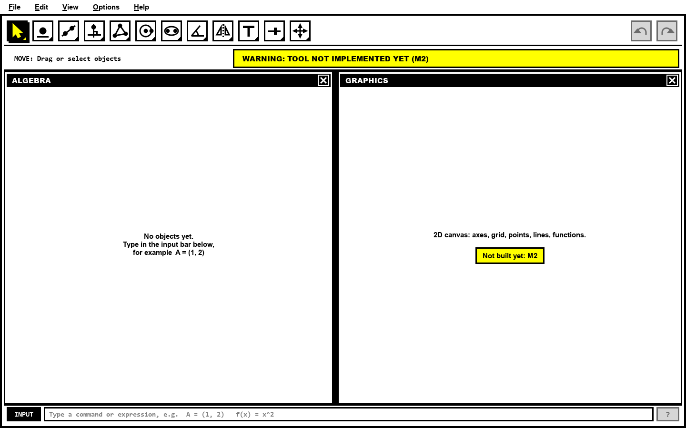
1. Menu bar: bold labels, hover inverts.
2. Toolbar: Move is selected: black button, yellow arrow, hard shadow. Triangles mark
   groups. Undo/redo on the right are disabled (grey).
3. Tool help in monospace; the yellow warning block says the Move tool arrives in M2.
4. Algebra and Graphics panels: black title bars, close buttons, 8 px black splitter.
5. Input bar: black INPUT chip, monospace field with a grey placeholder.

### All views (`screenshots/m0_all_views.png`)
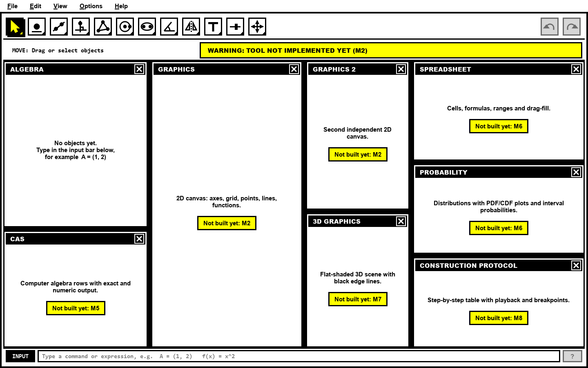
Every view panel visible as a dense rectangular grid. Each unbuilt view states its
milestone.

### Night theme (`screenshots/m0_night.png`) and high contrast (`screenshots/m0_high_contrast.png`)
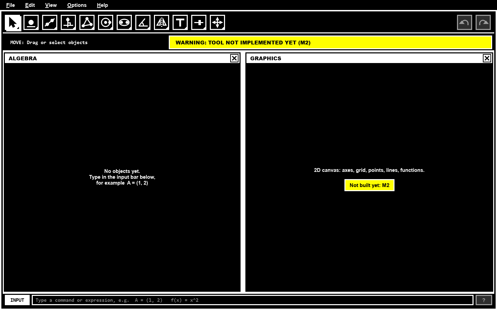
White borders and text on black; title bars invert to white with black text; the
selected tool is a white button with a black icon and a white shadow.

### Font size 20 pt (`screenshots/m0_font_20pt.png`)
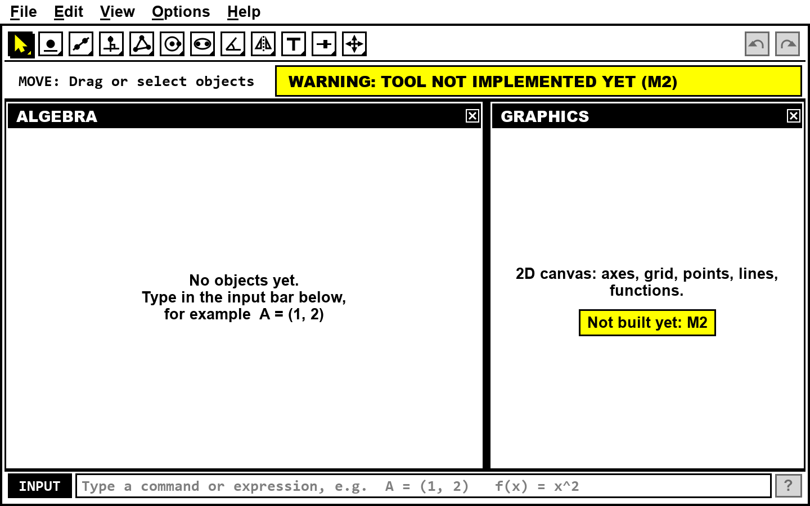
All chrome text scales; toolbar buttons keep their 44 px squares.

### Menus (`m0_menu_view.png`, `m0_menu_view_night.png`, `m0_tool_group_menu.png`)
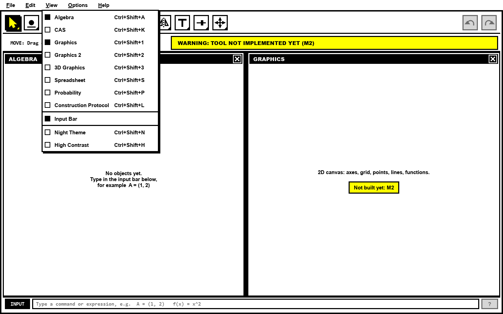
View menu: square check indicators (filled = on), 3 px separators, shortcuts, hard
shadow with corner notches.
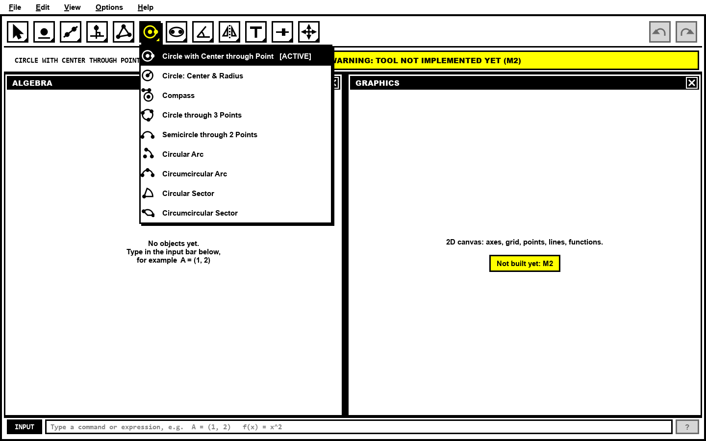
Circle tool group: 28 px icons, the active tool marked `[ACTIVE]` and highlighted.

### Tooltip (`screenshots/m0_tooltip.png`)
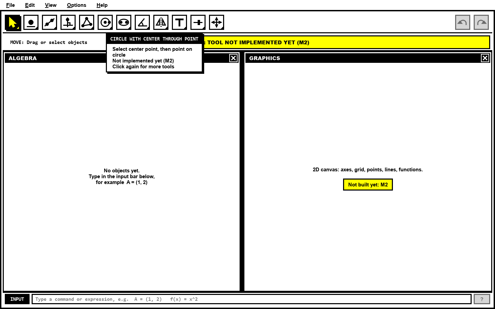
Monospace uppercase title chip, description, "Not implemented yet (M2)" line, hard shadow.

### Dialogs (`m0_dialog_about.png`, `m0_dialog_preferences.png`, `m0_dialog_confirm.png`)
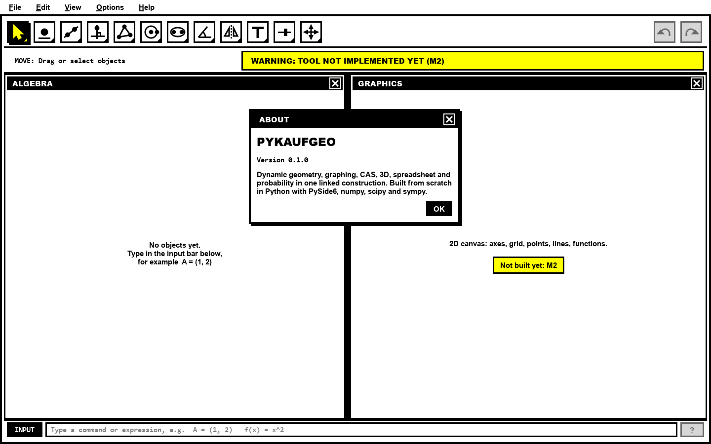
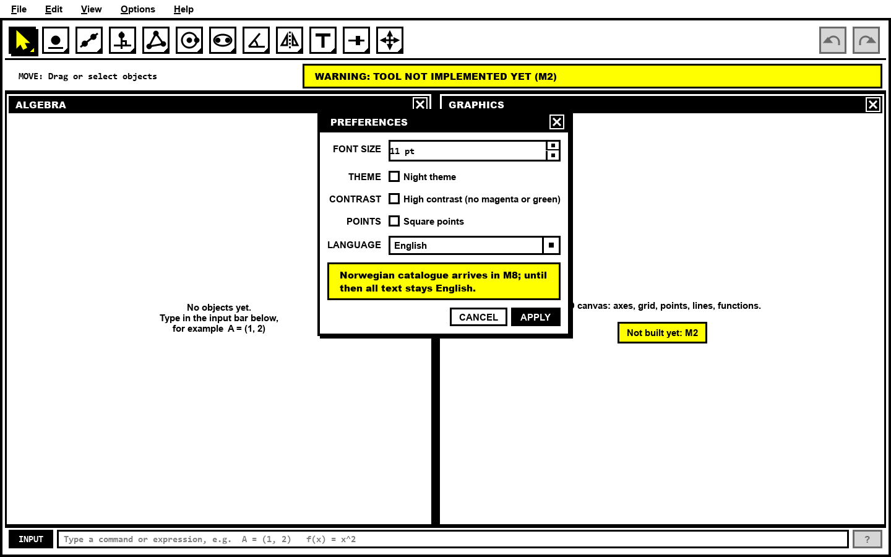
Font size, Night, high contrast, square points, language (with a warning that the
Norwegian catalogue arrives in M8).
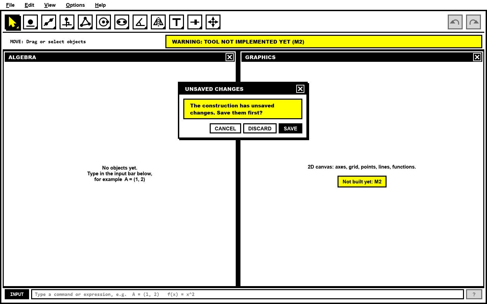

### Focus ring (`m0_focus_ring_toolbar.png`, `m0_focus_ring_input.png`)
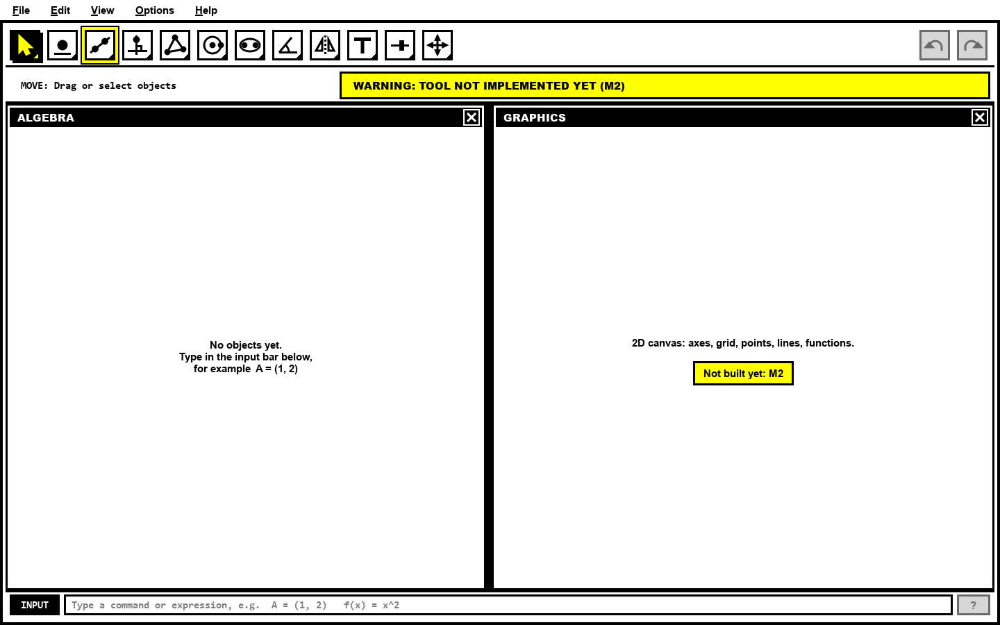
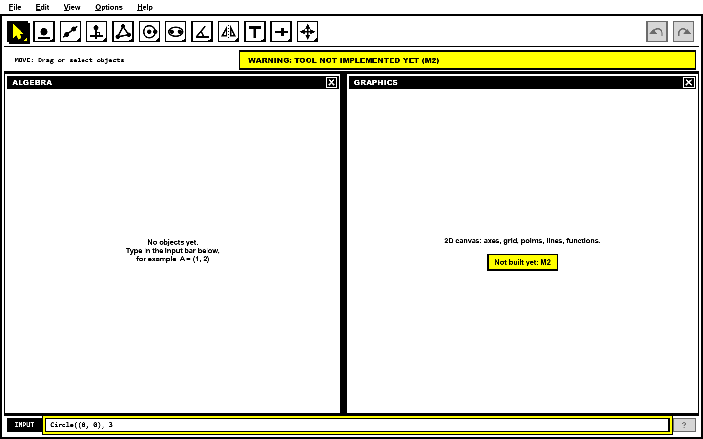
Keyboard focus on a toolbar button and on the input bar: black edge, 4 px yellow,
black edge, around the control's own 3 px border.

## 5. Screenshots (M1)

### Basic algebra list (`screenshots/m1_algebra_list.png`)
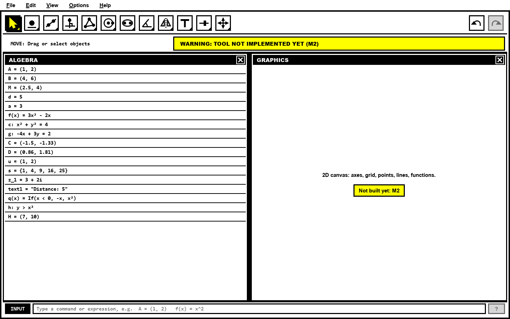
1. One monospace row per object, separated by 2 px rules (dense area). Equation
   types read `c: x² + y² = 4`; functions `f(x) = 3x² - 2x`; undefined values `?`.
2. Undo is enabled (black icon), redo disabled (grey).
3. The full Algebra view (grouping, toggles, colour squares, LaTeX) replaces this
   list in M2.

### Input error (`screenshots/m1_input_error.png`)
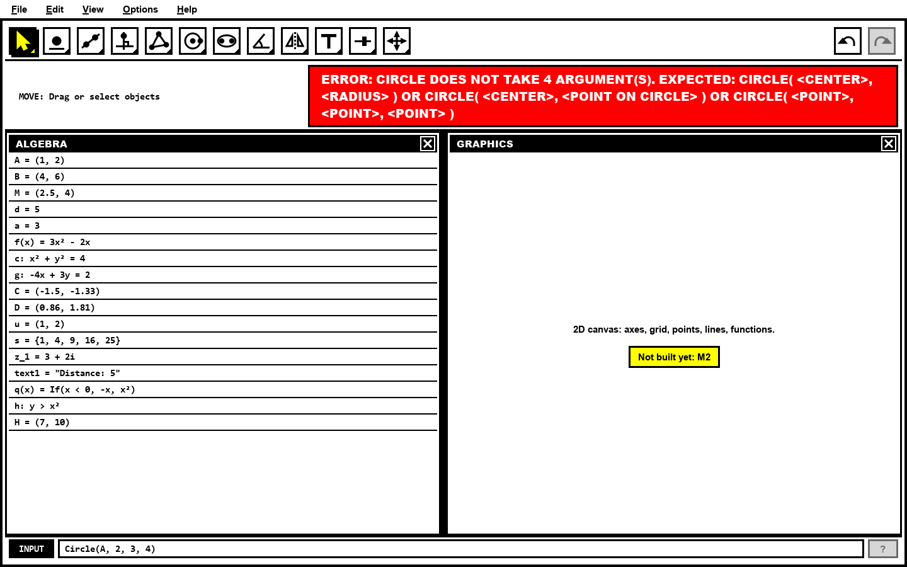
A specific, uppercase message in the red block (white heavy text, 14 pt minimum,
`ERROR:` prefix); the input text stays in the field for correction.

### Night theme with objects (`screenshots/m1_algebra_night.png`)
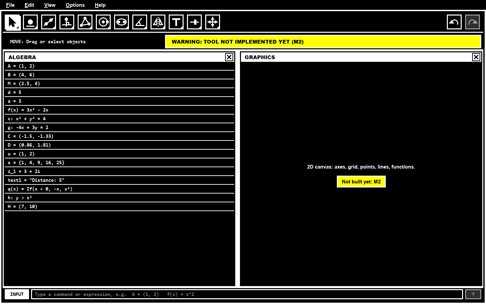

## 6. M2: graphics and algebra

### New tokens

| Token | Value | Where |
|---|---|---|
| `AXIS_WIDTH`, `TICK_LENGTH`, `AXIS_ARROW` | 3 px, 6 px, 10 px | axes with arrows at the positive ends |
| `GRID_WIDTH` | 1 px | grid lines in `grid_major` / `grid_minor` grey |
| `LINE_WIDTH`, `POINT_SIZE`, `POINT_OUTLINE` | 3 px, 5 (radius 6 px), 3 px | default object strokes and points |
| `SELECTION_EXTRA`, `HALO_WIDTH`, `HALO_EDGE` | +3 px, 8 px, 2 px | selected: thicker stroke, yellow halo, black halo edge |
| `CASING_WIDTH`, `GRAPHIC_CONTRAST` | 1 px, 3.0 | ink casing for strokes below 3:1 against the canvas (D-206) |
| `LABEL_GAP`, `SNAP_PX`, `HIT_TOLERANCE` | 6 px, 10 px, 8 px | label offset, grid snapping, pick distance |
| `DASH_PATTERNS`, `PREVIEW_DASH` | in line widths | dashed/dotted styles, rubber-band previews |
| `ALGEBRA_ROW_MIN`, `ALGEBRA_BOX` | 40 px, 16 px | algebra rows, visibility box and colour square |
| `MATH_FONT_*` | DejaVu Sans bold / bold italic | mathtext formulas (DejaVu ships with matplotlib, Bitstream Vera licence; nothing bundled by us) |

### Graphics state rules

| State | Rendering |
|---|---|
| Normal | object colour; points filled with a 3 px ink outline; polygons filled at 25 % with a 2 px ink edge |
| Low-contrast colour | 1 px ink casing each side (yellow/green by day, blue at night) |
| Hover | thin yellow halo with black edge |
| Selected | stroke +3 px, 8 px yellow halo with 2 px black edge, drawn above other objects |
| Square points (Options) | every round point drawn as a square |
| Labels | points only by default; object colour if at least 4.5:1 on the canvas, else ink |
| Night | black canvas, white axes and labels, grid in dark greys, same saturated object colours |

### Algebra rows

`[visibility box][colour square][formula][error chip]`. The box is filled when the
object is shown and hollow with a slash when hidden. Group headers are black bars
with a collapse triangle, uppercase name and count. Selected rows are yellow; hover
inverts. Undefined objects show `?`; objects whose recomputation failed carry a red
`!` chip, with the reason in the tooltip.

### Screenshots (M2)

#### Main window (`screenshots/m2_main.png`)

1. Algebra view grouped by dependency; formulas typeset (fractions, roots, superscripts).
2. The selected circle `c`: yellow row on the left, yellow halo with black edge on the right.
3. `tan(x)` and `floor(x) - 5` break at poles and jumps with no vertical spikes;
   `sqrt(x + 6)/2 - 6` starts exactly at its domain edge.
4. Free points blue, dependent point `M` ink, each with a 3 px outline and a label.
5. View bar: AXES (on = black with yellow text), grid type, 1:1 ratio lock.

#### Night and high contrast (`m2_night.png`, `m2_high_contrast.png`)
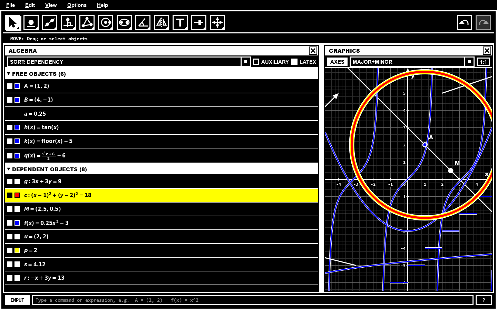
Blue curves carry a white casing at night (D-206); labels of blue points switch to white.

#### 20 pt fonts and square points (`m2_font_20pt.png`, `m2_square_points.png`)
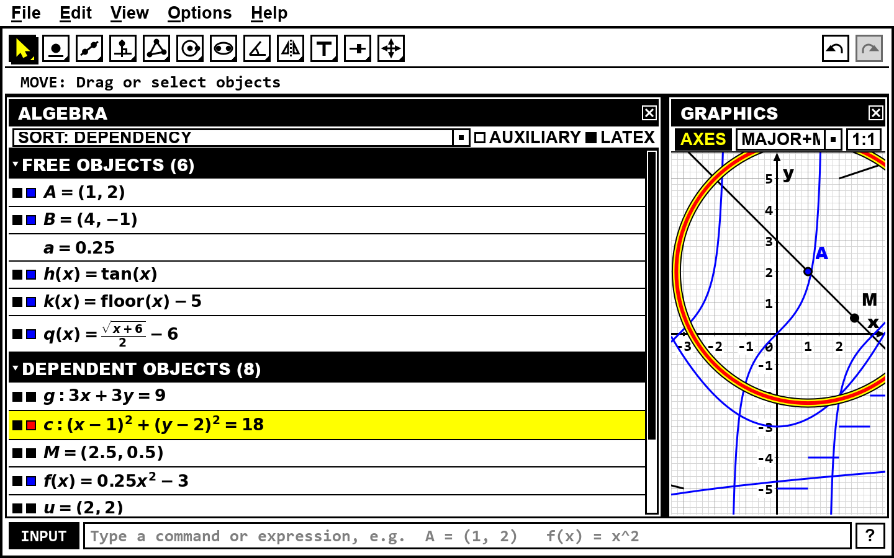
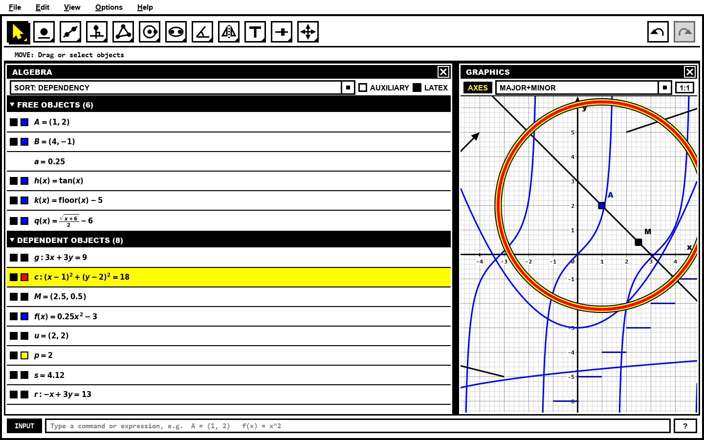

#### Two graphics views, polar grid (`m2_two_graphics_views.png`, `m2_polar_grid.png`)
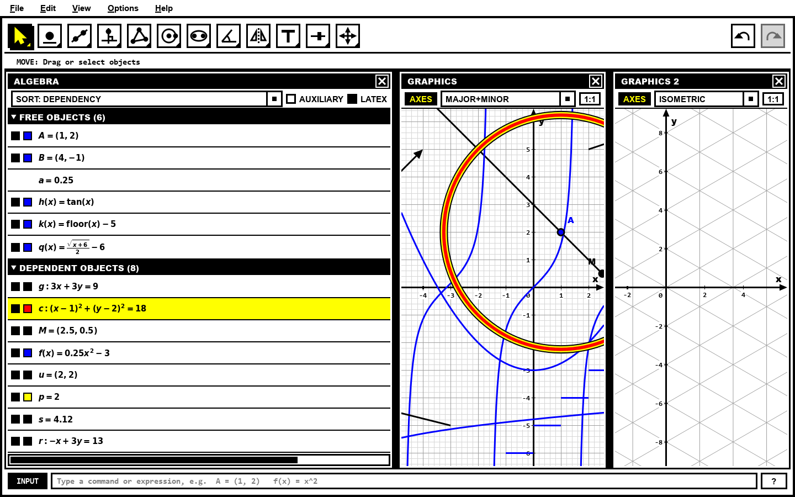
Graphics 2 has its own zoom and an isometric grid; objects created there stay there.

#### Algebra by type, inline editing (`m2_algebra_by_type.png`, `m2_algebra_inline_edit.png`)
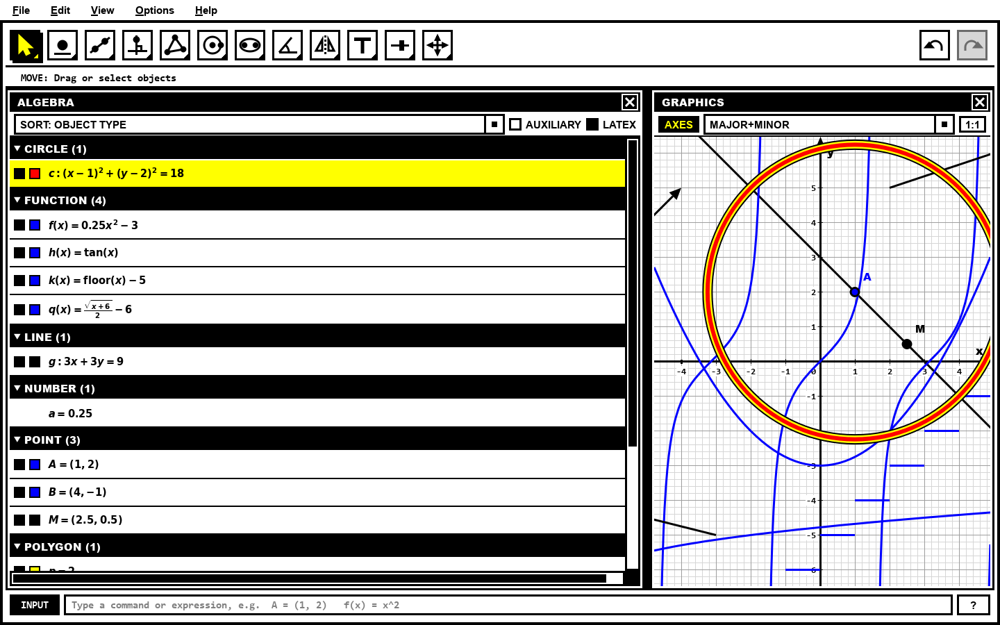
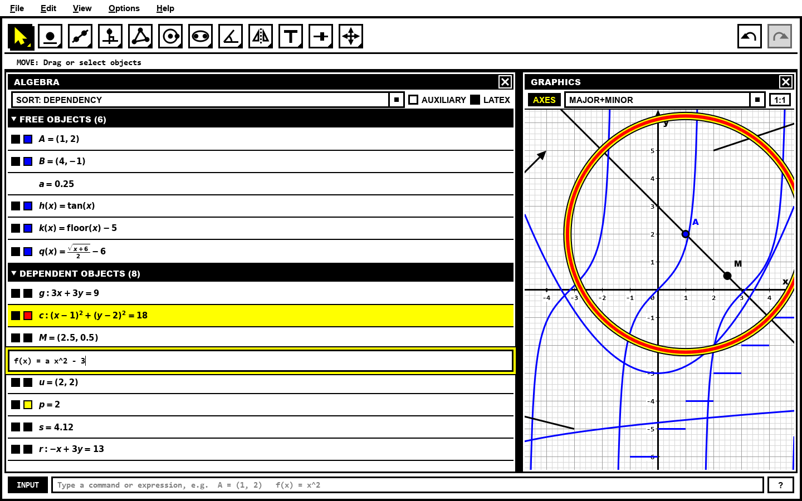
Double-click, F2 or Enter edits a row in place (monospace, focus ring); Enter applies,
Escape cancels, an error keeps the editor open with a red border.

#### Input bar (`m2_autocomplete.png`, `m2_argument_hint.png`, `m2_dialog_command_help.png`)
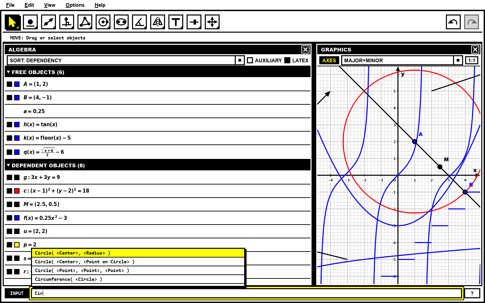
Three letters show matching syntaxes (hard-shadow popup, yellow selection).
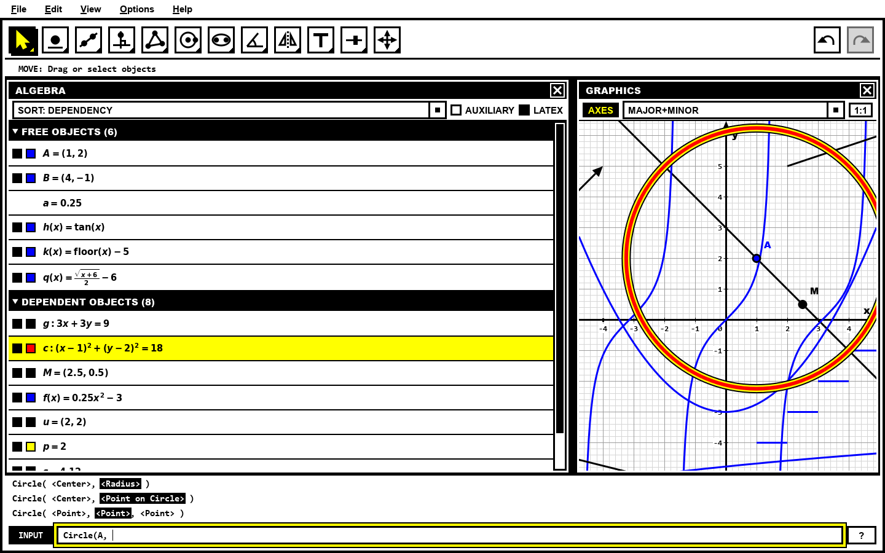
Inside a call, every fitting overload is listed with the current argument inverted.
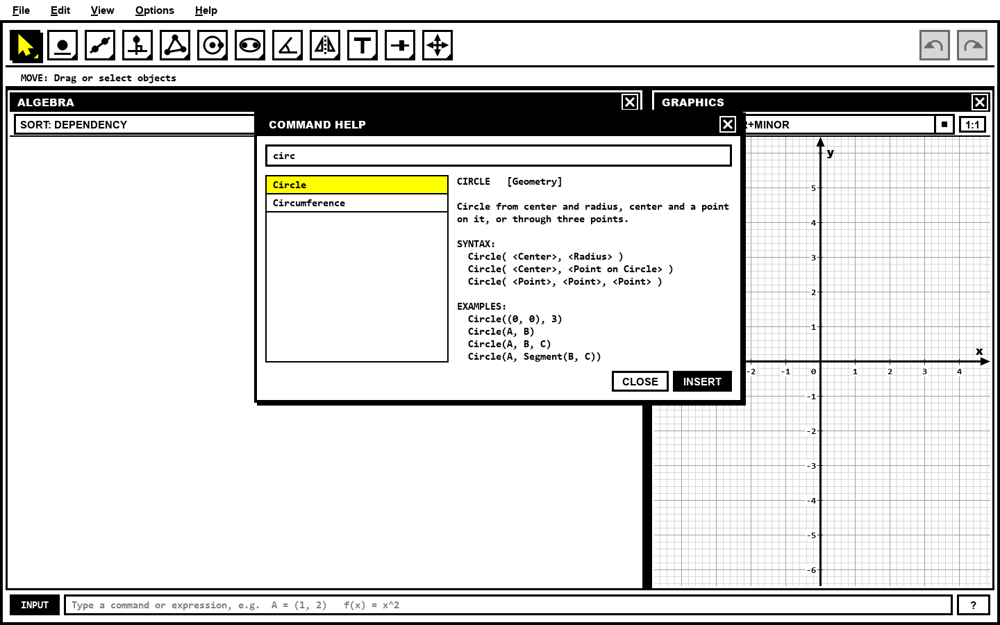
Command help (F1 or the ? button): search, syntax and examples, INSERT puts a
template in the input bar.

#### Graphics context menu (`m2_graphics_context_menu.png`)
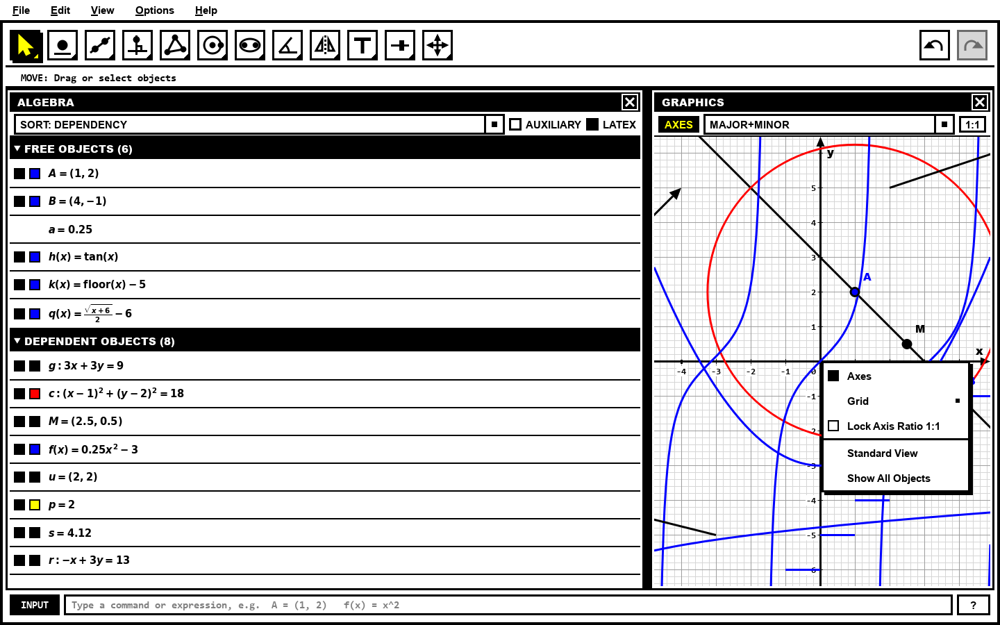
Right-click: axes, grid, ratio lock, standard view, show all. Right-drag zooms to a rectangle.
